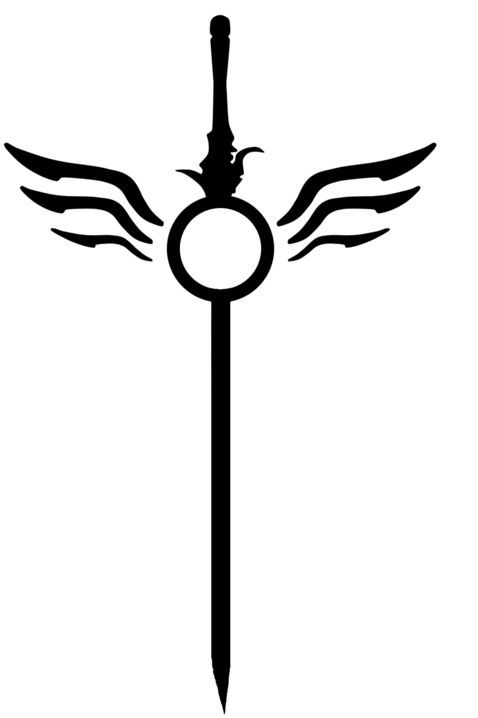

# D.A.N.T.E.

<p align="center">
  
</p>

<p align="center">
  <strong>Detection & Alerting Navigator for Threat Engineering</strong><br>
  <em>Plataforma Open Source de Engenharia de Detecção e Governança de Regras LogQL com telemetria Wazuh SIEM</em>
</p>

<p align="center">
  <a href="LICENSE"></a>
  
  
  
  
  
</p>

---

## 🧭 Visão Geral

O **D.A.N.T.E.** resolve o maior desafio operacional enfrentado por times de **SOC, Detection Engineering e MSSPs**: centralizar a **governança de detecções de segurança em escala multi-tenant** — quem possui qual regra, o que está pausado, quais exceções estão silenciando detecções críticas e se as queries LogQL escritas pelos analistas seguem os padrões de sintaxe e conformidade do pipeline de telemetria.

Atuando como um portal de governança e controle sobre as engines de detecção, regras e telemetria:

* 🏢 **Tripé Atômico por Tenant**: Cada cliente/ambiente é isolado em seu próprio repositório segregado, com base de telemetria dedicada e Grupo de Avaliação de `5m`.
* 🛡️ **Catálogo de Baseline Central (`global`)**: Regras institucionais vivem centralizadas e são replicadas com rastreabilidade (`cloned_from`) para os tenants.
* 🤖 **Curadoria de Regras com IA & Análise de Telemetria**: Motor inteligente com suporte a múltiplos provedores (**DeepSeek**, **OpenAI**, **Google Gemini**, **Anthropic Claude** e **Ollama/Local**) para tradução de regras Sigma, análise de cobertura e parecer técnico contextualizado em 5 faixas temporais.
* 🔍 **Linter LogQL Obrigatório no Servidor**: Validação sintática e de compliance de labels (`job="wazuh"` e agrupamento `rule_groups`) antes de persistir qualquer regra.
* 📦 **Importador de Regras YAML**: Suporte a pacotes no formato de regras analíticas com conversão de metadados, mapeamento MITRE ATT&CK e autocriação de tecnologias.
* 🚦 **Ciclo de Homologação via Contact Points**: Regras novas e clonadas nascem em estágio de teste (`dev`/`stg`). A promoção para produção (`prod`) é controlada.
* 🔇 **Gestão de Exceções & Silences com Natureza Explícita**: Separação clara entre *Exceções Permanentes* (10 anos no servidor, apenas revogação) e *Silences Temporários* (antiflood/manutenção).
* 🧪 **Telemetry Synthetic Lab**: Laboratório integrado para injeção de telemetria sintética com presets de técnicas do MITRE ATT&CK para validar o disparo de alertas.

---

## 🎯 Casos de Uso

| Cenário | Como o D.A.N.T.E. atua |
| :--- | :--- |
| **MSSPs & SOCs Multi-Cliente** | Isola cada cliente em seu próprio tenant com base de telemetria segregada, permitindo aplicar o baseline institucional de segurança em lote e acompanhar a taxa de adesão em tempo real. |
| **Times Corporativos de Detection Engineering** | Centraliza o ciclo de vida de regras: elaboração com auto-complete LogQL, testes com telemetria sintética, esteira de homologação (`dev` → `stg` → `prod`) e auditoria de silences. |
| **Modernização de SIEM (Wazuh Telemetry)** | Aproveita o baixo custo e alta velocidade indexando logs do Wazuh (`job="wazuh"`, `rule_groups`), adicionando a camada de governança analítica que faltava ao stack. |
| **Engenharia de Detecção Assistida por IA** | Realiza triagem automática de novos repositórios de regras (SigmaHQ), traduz regras para LogQL e gera pareceres em 3 estrelas baseados no tráfego real do cliente nas últimas horas/dias. |

---

## ⚡ Início Rápido (Quickstart)

### Pré-requisitos
* **Docker Engine** 24.0+ e **Docker Compose** v2+
* Mínimo de **2 GB de RAM** livre (4 GB recomendados para ambientes com alta ingestão de logs)
* Portas livres no host: `8080` (Portal D.A.N.T.E.)

### 1. Clonar o Repositório
```bash
git clone https://github.com/sg0luc/dante.git
cd dante
```

### 2. Configurar o Ambiente
Copie o modelo de variáveis de ambiente e defina as senhas administrativas:
```bash
cp .env.example .env          # Linux/macOS
Copy-Item .env.example .env   # Windows PowerShell
```

Edite o `.env` e preencha as credenciais obrigatórias:
```env
PORTAL_ADMIN_USER=hunter
PORTAL_ADMIN_PASSWORD=SuaSenhaForteAqui123!
```

### 3. Subir a Stack
```bash
docker compose up -d
```

### 4. Acessar a Plataforma
* **Portal D.A.N.T.E.**: [http://localhost:8080](http://localhost:8080)
  * Login padrão: usuário e senha definidos em `PORTAL_ADMIN_USER` e `PORTAL_ADMIN_PASSWORD`.

---

## 🏗️ Arquitetura do Sistema

```
                      ┌────────────────────────────────────────┐
                      │          Navegador do Analista         │
                      └───────────────────┬────────────────────┘
                                          │ :8080
                                          ▼
                      ┌────────────────────────────────────────┐
                      │      Frontend (React 18 + Nginx)       │
                      └───────────────────┬────────────────────┘
                                          │ Proxy reverso /api
                                          ▼
                      ┌────────────────────────────────────────┐
                      │      Backend API (FastAPI / Py3.12)    │
                      │ • Linter LogQL  • Motor IA  • Sessões  │
                      └─────────┬───────────────────┬──────────┘
                                │                   │
       Engine Auth (0400)       │                   │ LogQL Queries / Push
                                ▼                   ▼
              ┌─────────────────────────┐     ┌────────────────────────┐
              │     Alerting Engine     │     │    Telemetry Engine    │
              │   (Alerting & Folders)  │ ──> │ (Telemetria do Wazuh)  │
              └─────────────────────────┘     └────────────────────────┘
```

### Modelo de Dados e Pipeline do SIEM
O D.A.N.T.E. adota por padrão a convenção de eventos do **Wazuh**:
* **Pipeline de Ingestão (`job`)**: Identificado por `job="wazuh"`.
* **Segregação de Tecnologias (`rule_groups`)**: Espelho canônico do campo `rule.groups` do Wazuh (ex: `.*windows.*`, `.*fortigate.*`, `.*office365.*`). Também mantém compatibilidade com rótulos customizados ou legados (`ss_groups`).
* **Estrutura de Regra LogQL Recomendada**:
  ```logql
  count_over_time(
      {job="wazuh", rule_groups=~".*windows.*"}
      | json
      | win_system_eventID = "4728"
      [5m]
  )
  ```

---

## ⚙️ Modos de Implantação

O D.A.N.T.E. suporta operação standalone e integração externa via `COMPOSE_PROFILES`:

1. **Standalone (Padrão - `COMPOSE_PROFILES=default`)**:
   * Sobe todos os componentes em containers locais: Portal, Engine de Alertas, Engine de Telemetria e Bootstrap automático.
   * Ideal para PoCs, novos ambientes e laboratórios.

2. **Engine Externa (`COMPOSE_PROFILES=external`)**:
   * Conecta a uma infraestrutura analítica externa corporativa pré-existente via credenciais de serviço.

---

## 🤖 Integração com Inteligência Artificial

O portal conta com um subsistema completo de IA para acelerar o desenvolvimento de engenharia de detecção:
* **Provedores Suportados**: DeepSeek (`deepseek-chat`, `deepseek-reasoner`), OpenAI (`gpt-4o-mini`, `gpt-4o`), Google Gemini (`gemini-2.0-flash`, `gemini-1.5-flash`), Anthropic Claude (`claude-3-5-haiku`, `claude-3-5-sonnet`) e Ollama (modelos locais).
* **Curadoria e Tradução de Regras**: Conversão de regras Sigma com validação semântica e correção automática de sintaxe LogQL.
* **Avaliação de Telemetria em 5 Janelas Progressivas**: Avalia o impacto de regras pausadas ou candidatas em faixas de 15m, 1h, 6h, 24h e 3 dias antes da reativação.
* **Segurança e Privacidade**: As chaves podem ser configuradas no `.env` ou pela UI (`/api-keys`), são gravadas com criptografia/mascaramento e nunca são expostas no tráfego HTTP.

---

## 🛡️ Segurança e Hardening

* **Princípio do Menor Privilégio**: Containers rodam com `no-new-privileges:true`, `cap_drop: [ALL]` e sistemas de arquivos de container em modo leitura (`read_only: true` onde aplicável).
* **Proteção contra CSRF**: Validação rigorosa em camadas com cookies `SameSite=Strict`, flags `HttpOnly` e cabeçalhos customizados obrigatórios.
* **Credenciais Protegidas**: Os tokens de comunicação com os motores internos são emitidos dinamicamente pelo bootstrap, armazenados em volume seguro com permissão `0400` e nunca transitam pelo navegador.
* **Telemetria Isolada**: Sem autenticação exposta na borda; a comunicação interna fica vinculada exclusivamente à rede interna `core-net` do Docker.

---

## 📄 Licença

Distribuído sob a licença **Apache 2.0**. Consulte o arquivo [LICENSE](LICENSE) para obter o texto integral dos termos e condições de uso, modificação e distribuição.

---

<p align="center">
  Construído com dedicação para a comunidade de <strong>Threat Engineering</strong> & <strong>SOC Operations</strong>.
</p>
